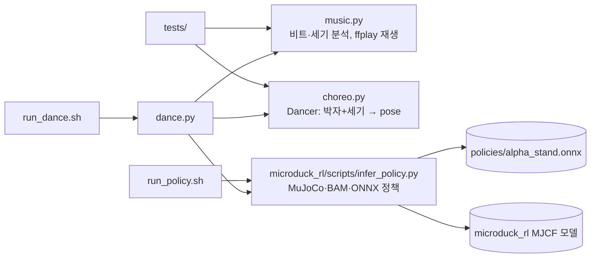
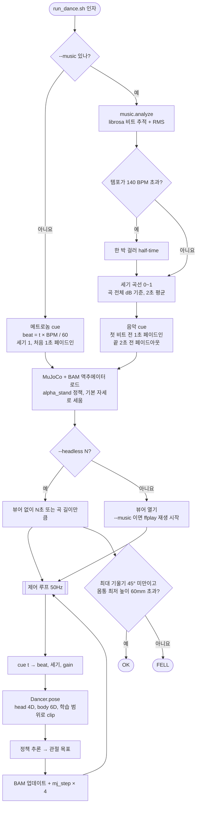
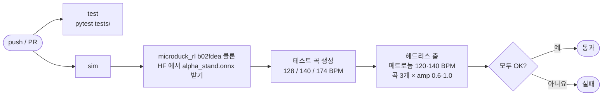

# Microduck × MuJoCo 워크스페이스

Pollen Robotics의 microduck을 MuJoCo에서 구동하고, 박자에 맞춰 춤추게 만드는 워크스페이스입니다.

- **시뮬레이션·정책 추론**: CPU MuJoCo로 동작 (GPU 없어도 됨)
- **정책 학습**(mjlab / MuJoCo Warp): CUDA GPU 필요. 이 PC는 RTX 5080 Laptop(16GB)으로 학습 가능
- 실물 로봇은 2027년 1월경 수령 예정이라 지금은 시뮬레이션 우선

작업 경과와 테스트 결과는 [NOTES.md](NOTES.md) 참고.

## 구성

```
microduck_rl/   pollen-robotics/microduck_rl (MJCF 모델, scripts/infer_policy.py)   ← 별도 클론
policies/       HF kyoungsim/microduck 의 ONNX 정책 (alpha_walking/alpha_stand/alpha_sitstand/roulade) ← 별도 다운로드
.venv/          mujoco 3.x, onnxruntime, BAM(락된 커밋 62bd8ce) — uv로 생성      ← 커밋하지 않음
run_viewer.sh   모델만 둘러보기 (키프레임 INIT/STAND/SIT/FOLD)
run_policy.sh   정책 구동 + 키보드 조작
dance.py        박자·음악에 맞춰 춤추는 데모
music.py        음악 비트·세기 분석(librosa)과 재생(ffplay)
choreo.py       춤 동작 (박자 위상 + 곡의 세기 -> 머리/몸체 pose 명령)
tests/          music/choreo 테스트, 테스트 곡 생성기
run_dance.sh    dance.py 실행 래퍼
NOTES.md        작업 경과, 테스트 결과, 문제 원인과 수정 기록
.github/workflows/dance.yml   CI: 테스트 + 헤드리스 춤 낙상 점검
```

### 파일 관계



`microduck_rl/`, `policies/`, `.venv/` 는 `.gitignore`로 제외되어 있습니다.

## 준비

```bash
# 1. Pollen 레포 (작업 당시: develop 브랜치, 커밋 b02fdea)
git clone -b develop https://github.com/pollen-robotics/microduck_rl.git

# 2. ONNX 정책: Hugging Face kyoungsim/microduck 에서 받아 policies/ 에 넣기
#    파일명: alpha_walking.onnx, alpha_stand.onnx, alpha_sitstand.onnx, roulade.onnx

# 3. 가상환경: uv로 .venv 생성 후 mujoco, onnxruntime, BAM(62bd8ce) 설치
#    uv는 ~/.local/bin/uv (PATH에 없으면 export PATH=$HOME/.local/bin:$PATH)

# 4. 음악 춤용 (선택)
uv pip install --python .venv/bin/python librosa soundfile
sudo apt install ffmpeg        # 재생용 ffplay
```

## 사용

```bash
./run_viewer.sh                         # 정적 뷰어
./run_policy.sh walk                    # 걷기 정책만
./run_policy.sh                         # 4개 정책 핫스왑 (걷기/서기/앉기·서기/roulade)
./run_policy.sh walk --lin-vel-x 0.2    # 처음부터 전진 명령
./run_policy.sh walk --no-bam           # BAM 액추에이터 대신 XML PD (학습 조건과 다름)
./run_dance.sh --bpm 120                # 춤 데모
./run_dance.sh --bpm 120 --headless 20  # 뷰어 없이 20초 돌려 넘어지는지 점검
./run_dance.sh --music song.mp3         # 음악을 틀고 비트·세기에 맞춰 춤
./run_dance.sh --music song.mp3 --headless 999   # 곡 전체를 소리·뷰어 없이 돌려 낙상 점검
```

- `run_policy.sh` 의 추가 인자는 `infer_policy.py` 로 그대로 전달됩니다 (`--debug`, `--save-csv`, `--record` 등).
- `run_dance.sh` 옵션: `--bpm`(기본 120), `--amp` 동작 크기 0~1(기본 0.6), `--headless N`,
  `--music 파일`, `--latency 초`(기본 0.1), `--mute`. 자세한 건 아래 "춤 데모" 참고.
- 키보드는 **실행한 터미널 창에 포커스**를 두고 입력합니다 (MuJoCo 창 아님). 백그라운드 실행처럼 stdin이 TTY가 아니면 키 입력이 안 됩니다.
- 종료는 `Q` 또는 뷰어 창 닫기.

## 키맵 (`infer_policy.py` 의 `handle_key` 기준)

속도 키는 누르는 즉시 최대/최소값으로 설정됩니다 (조금씩 증가하는 방식 아님).

| 키 | 동작 |
|---|---|
| `↑` / `↓` | 전진 / 후진 (±0.3 m/s) |
| `←` / `→` | 좌 / 우 옆걸음 (±0.2 m/s) |
| `A` / `E` | 좌 / 우 회전 (1.5 rad/s) |
| `Space` | 속도 명령 0 (정지) |
| `Y` | 앉기/서기 (핫스왑 모드, sitstand) |
| `R` | roulade (핫스왑 모드) |
| `P` | 랜덤 푸시 |
| `T` | 정책 추론 on/off |
| `H` | 머리 모드 토글: `↑↓` head_pitch, `←→` head_yaw, `A/E` head_roll, `Z/S` neck_pitch, `Space` 리셋 |
| `B` | 몸체 자세 모드 토글: `↑↓` z, `←→` pitch, `A/E` roll, `Z/S` yaw, `Space` 리셋 |
| `Q` | 종료 |

`G`(ground pick), `K`/`L`(킥)은 해당 정책 옵션이 필요해 현재 스크립트로는 동작하지 않습니다.

## 춤 데모 (`dance.py`)

서 있는 정책(`alpha_stand.onnx`)의 머리·몸체 pose 명령을 박자 위상에 맞춰 흔듭니다. 새로 학습하지 않으며 Pollen 레포도 수정하지 않습니다(`infer_policy.py` 를 import).

### 동작 흐름



뷰어 모드의 시각 `t` 는 음악이 있으면 ffplay 재생 경과 시간 − `--latency`, 없으면 시작 후 경과 시간입니다.

- 매 박 고개 끄덕, 2박마다 무릎 굽힘(z), 좌우 체중 이동(roll), 앞뒤 까딱(pitch), 머리 갸웃(yaw)
- `--bpm`: 고정 템포 메트로놈. 모든 동작을 최대로
- `--music 파일`: mp3/wav/ogg/flac 을 librosa 로 분석해 비트 시각과 곡의 세기(에너지)를 뽑고, ffplay 로 틀면서 춤춘다

음악 모드에서 곡의 세기에 따라 동작이 쌓입니다 (세기는 1마디 단위로 부드럽게).

| 세기 | 동작 |
|---|---|
| 조용함 | 고개만 작게 끄덕 |
| 중간 | + 좌우 체중 이동, 머리 갸웃 |
| 큼 | + 무릎 바운스, 앞뒤 까딱 (= 메트로놈 춤과 같은 크기) |

- 어떤 세기에서도 동작 크기는 메트로놈 춤(같은 `--amp`)보다 커지지 않습니다.
- 140 BPM 보다 빠른 곡은 한 박 걸러(half-time) 춤춥니다. 테스트해 본 최대 템포가 140 BPM 이라서입니다.
- 곡 시작 전 1초 동안 페이드인, 끝나기 2초 전부터 페이드아웃 후 정지 자세.
- 동작이 소리보다 빠르면 `--latency` 를 키우고, 늦으면 줄이세요 (ffplay 시작 지연 보정).
- 메트로놈 모드도 시작 후 1초 동안 페이드인합니다. 페이드인이 없을 때는 `--bpm 140 --amp 1.0` 이 시작 0.98초에 넘어졌습니다 (지금은 CI 헤드리스 점검 통과).
- 헤드리스 점검은 끝나면 한 줄로 최저 몸통 높이·최대 기울기를 출력하고, 기울기 45° 미만·몸통 높이 60mm 초과면 `OK`, 아니면 `FELL` 입니다.
- 테스트: `.venv/bin/python -m pytest tests/` (librosa, soundfile, pytest 필요).
  테스트 곡은 `python tests/make_test_song.py song.wav --bpm 128` 로 만들 수 있습니다.

### CI (`.github/workflows/dance.yml`)

push·PR 때마다 두 작업이 돕니다.



`--music song140.wav --amp 1.0` 결과는 참고용으로만 남기고 통과 여부에는 넣지 않습니다.

## 로봇·정책 규약 (microduck_rl/AGENTS.md 요약)

- 관측 61D = 기본 48 + 명령 13D `[twist(3), head_pose(4), body_pose(6)]`. 모든 정책이 공유하므로 `--new-cmd-obs` 필수 (스크립트에 포함됨)
- 관절 14개: 0–4 왼다리, 5–8 목/머리(neck_pitch, head_pitch, head_yaw, head_roll), 9–13 오른다리
- 학습 범위: head_pitch/neck ±1.1, head_yaw ±1.4, head_roll ±0.31, 몸체 z ±30mm, 몸체 각도 ±30°
- body_cmd 순서: `[x, y, z, roll, pitch, yaw]`
- 50Hz 제어, 시뮬레이션 timestep 0.005s, decimation 4
- 액추에이터는 BAM(XL330 전압 제어 모델). 정책은 필터 없이 학습됨
- 학습 시작 전에는 항상 64 env × 5 iter 스모크 테스트
- 다른 정책은 `policies/` 에 넣고 `run_policy.sh` 의 경로만 바꾸면 됩니다

## 출처 / 라이선스 (법률 자문 아님)

| 대상 | 라이선스 | 이 레포 포함 여부 |
|---|---|---|
| microduck_rl 코드, MJCF, 설정 | Apache 2.0 (Pollen Robotics) | 미포함 (클론 안내만) |
| microduck_rl 의 STL 3D 모델 | CC BY-NC-SA 4.0 — 비영리, 크레딧, 동일 라이선스 | 미포함 |
| `policies/*.onnx` (HF kyoungsim/microduck) | 모델 카드 메타데이터상 MIT (2026-11-16 확인, 본문 미확인) | 미포함 (다운로드 안내만) |
| README, NOTES, `run_*.sh`, `dance.py`, `music.py`, `choreo.py`, `tests/`, CI 설정 | 직접 작성 | 포함 |
